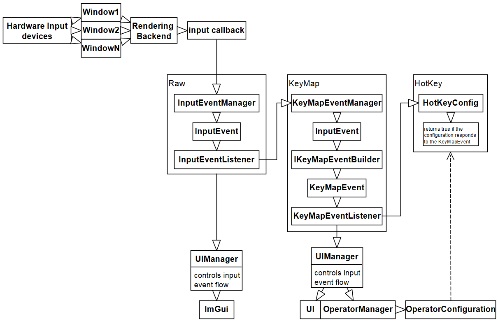

# Architecture
The input / hotkey system is divided into three layers:
- The first layer is the `raw` module that receives the raw input events directly from the hardware / rendering backend.
This layer acts as an interface for the rendering backend and the input events the app requires. The input events therefore should be
very general purpose and not too specific for the rendering backend used. For example: The `KeyEvent` does not contain the
key mods, as those are just held down keys like `ctrl`, `alt` etc. which makes more sense to be processed and detected in the later
stages of hotkeys and keymap events.  Keeping them general purpose allows full flexibility with the inputs and backend and won't require changes
in the logic of the keymap builders.
- The second layer is the `keymap` module. This module converts a raw input event into a usable keymap event for the
application and UI. This layer acts as an interface for the raw input events and the UI layer.
- The third layer contains the actual hotkey configurations. These are independent of the types of keymapevents. A HotKey
configuration is part of the datatree and has values that determine to what kind of keymap event it responds to.

The event flow can be visualized as following:

# `raw` module
This module contains basic input events and the core listener framework for the hardware inputs. 
An InputEventManager (implementing `IInputEventManager`) has listeners and a public method to notify the listeners. This is important
to allow future custom input events being fed into the system externally.  
There is a predefined implementation for LWJGL `LWJGLInputEventManager` that has the logic to create the correct `InputEvent` for 
the OpenGL input callback.  
The input events are kept basic and should only contain the most necessary information. 
This will allow the backend, openGL or other rendering backends, to be exchangeable.  Example: the `KeyEvent` does not
contain the key modifiers supplied by OpenGL. This is because we don't know if all backends will supply them, also the KeyEvent in its
most basic form is just about a key being pressed, released or repeatedly held down. Key modifiers are just keys that are held down, they can be
cached and processed in later stages of other modules. Therefore, key modifiers are unnecessary and additional information.

# `keymap` module
This module contains the core logic and frameworks for converting raw input events and building the keymap events.  
For every `InputEvent` class one `IKeyMapEventBuilder` can be assigned (in `KeyMapEventManager`) that converts the input event into a keymap event.
The module is designed with the builder pattern. The `KeyMapEventManager` is the central object that takes input events
and uses the builder to build keymap events. This object also notifies the keymap event listeners. 
Important predefined classes used by the base framework: `IMousePosEventProvider`, `IKeyEventBuilder`, `KeyMapKeyEvent`
  
There is one predefined builder interface available: `IKeyEventBuilder` 
This builder builds a `KeyMapKeyEvent` (another predefined keymap event type for events that are about a key being pressed). 
This is necessary to allow the `KeyMapEventManager` to build click/double-click events and to define the pressed keys Set.  
The event `KeyMapKeyEvent` is general purpose, any custom data or custom key can be defined with it. It defines the method
`equalKey(KeyMapKeyEvent)` to allow custom keys for subclasses. This method is crucial for the pressed keys Set 
to prevent equal keys being inserted into it and to replace them properly. 
If you want to create a `KeyMapEvent` that represents a key being pressed/released etc., you should use these classes.
  
The predefined interface `IMousePosEventProvider` allows a builder to provide a mouse position for the input event.
This is necessary to provide the `KeyMapEventManager` with the current mouse position, and it allows custom cursor events like
tablet events etc.
  
The `PressedKeySet` is a special Set implementation for held down keys. You can only add `KeyMapKeyEvents` 
that are either `PRESS` or `REPEAT` types. The set stores the original event, which allows custom event data to persist
and be used later on when retrieving held down keys. 
The Set will only contain events triggered by unique keys. 
The `KeyMapKeyEvent.equalKey(KeyMapKeyEvent)` method is used to verify that an event with the same key is not already stored. 
The Set also stores a list of mouse positions for every event, that were recorded
while a key is held down. This allows to trigger movement-based events for keys.

# `hotkey` module
This module does not contain events and is independent of the event system. This module contains the logic and data for
hotkey configurations. A `HotKeyConfig` is the base class for a configuration that responds to a `KeyMapEvent`. Every hotkey
config is therefore a `IKeyMapEventListener` and returns true when the event aligns with the hotkey configuration.
  
`HotKeyConfig` subclasses define the logic when to respond to a `KeyMapEvent` and when to stop responding.
  
Every `HotKeyConfig` subclass needs to be registered in the `HotKeyConfigRegistry` so they can be properly stored and instantiated
in the data tree for the `HotKeyConfigSelectorEnum`. This enum stores one hotkey configuration and allows to select from all available hotkey
configuration types.